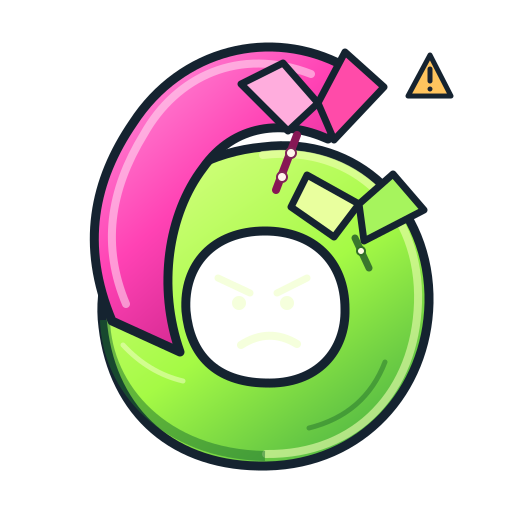

<div align="center">
  
  <h1>Rizzer</h1>
  <p><strong>Two collars. Zero trust.</strong></p>
  <p>The official 6lowStick mascot · An independent native fuzzer</p>
</div>

**A small, independent, coverage-guided native fuzzer for reproducible experiments.**

**Status:** experimental Linux research engine · Apache-2.0 · synthetic fixtures only.

## Meet Rizzer

**Rizzer the Siamese Polo Shirts** is one character shared by two independently maintained projects: [6lowStick](https://github.com/mcc0nnell/6lowstick), where he is the official mascot, and **Rizzer**, the standalone fuzzing engine. Two joined hot-pink and lime-green polos, two popped collars, and one unmistakable six. 

The layered-polo look is an affectionate, unofficial Loopt-era pop-culture reference—not an affiliation or endorsement. Imagine a millennial Leisure Suit Larry who understands pointer arithmetic. **He flirts with bugs, not people**, and never confuses a sanitizer report with a confirmed vulnerability.

Meet him without starting a campaign:

```bash
python3 mascot.py --demo
# RIZZER // MEET THE MASCOT
# Two collars. Zero trust. And excellent taste in reproducible experiments.
```

Or let him comment on an **existing** local evidence file:

```bash
python3 mascot.py --evidence /path/to/campaign/evidence.json
```

This is read-only, deterministic, opt-in human commentary. It never modifies evidence, changes fuzzing status, or claims a confirmed finding. [Character bible and art guidance](docs/character.md).

### Five expressions, one Rizzer

| Smug | Investigating | Surprised | Celebrating | Caution |
| :---: | :---: | :---: | :---: | :---: |
|  |  |  |  |  |

All six SVGs (five variants and the master) are generated from [readable source](scripts/build_mascot.py), not raster-upscaled. Rebuild with `python3 scripts/build_mascot.py`. No external fonts, SVG images, scripts, or CDN dependencies.

### Terminal cameo

```bash
python3 terminal.py --pose smug              # static, no terminal required
python3 terminal.py --pose investigating --plain
python3 terminal.py --pose celebrating --animate
python3 terminal.py --animate --reduced-motion
```

Animation is **opt-in**, four frames maximum, and only runs when stdout is a terminal. Piped output, `--plain`, reduced-motion preference and `NO_COLOR` are handled without changing any fuzzing outcome. The terminal cameo never invokes a campaign. `mascot.py --evidence` remains a separate, read-only narrator for real reports.

## What it does

- Compiles C or C++ harnesses with **Clang trace-pc-guard**, **ASan**, and **UBSan**.
- Exercises deterministic, bounded mutation campaigns with a retained coverage corpus.
- Runs each input in a forked subprocess, reporting signals, sanitizer failures and timeouts.
- Preserves input, compiler identity, source digests, journal, crash logs and JSON evidence.
- Replays exact failure bytes; supports opt-in, evidence-preserving crash reduction.
- Offers an optional Docker wrapper with a pinned image, no default network and resource limits.

This is **not** an authorization framework, production-grade sandbox, or proof of a vulnerability. A fork isolates process state, **not** untrusted code from the host.

## Requirements

Linux, Python 3.11+, Clang/Clang++ with compiler-rt sanitizer support, and a C++17-capable toolchain. Docker is optional and is only for the separately reviewed `isolated.py` path.

## Run the synthetic acceptance suite

```bash
python3 -m unittest discover -v -p 'test_*.py'
```

On Butcher, the imported baseline passed **19/19 synthetic tests** on October 21, 2026. This is local verification, not hosted CI or independent security assurance.

## Your first fuzzing campaign

```bash
mkdir -p /tmp/rizzer-seeds
printf '\0' > /tmp/rizzer-seeds/zero
python3 run.py \
  --source fixtures/safe.c \
  --corpus /tmp/rizzer-seeds \
  --out /tmp/rizzer-safe-01 \
  --runs 96 --seed 17 --seconds 15
cat /tmp/rizzer-safe-01/evidence.json
```

`--out` must name a **new** directory. Never point it at important existing files.

A failure demonstration is included as a synthetic fixture:

```bash
python3 run.py --source fixtures/buggy.c \
  --corpus /tmp/rizzer-seeds --out /tmp/rizzer-buggy-01 \
  --runs 96 --seed 17 --seconds 15
```

The synthetic buggy fixture is expected to produce a nonzero runner exit and retained ASan evidence.

## Evidence boundaries

- `evidence.json`: source/compiler/runner identity, commands and reported outcome.
- `summary.json`, `journal.jsonl`: campaign summary and per-input records.
- `findings/`: candidate crash bytes and diagnostic logs; **candidates are not security findings**.
- `retained/`: coverage-growth corpus.
- `minimize.py`: bounded reproduction and simplification of a previously recorded synthetic failure; see [MINIMIZATION.md](MINIMIZATION.md).

Current v0 code intentionally retains identifiers such as `ihb.native-fuzz-evidence.v0` and `IHBTestOneInput` so imported fixtures and evidence remain reproducible. These are **compatibility names**, not a runtime dependency on IHB. Any future Rizzer-native schema and harness ABI will be explicitly versioned rather than silently rewriting evidence.

## Integrations: independent by design

| Consumer | Intended boundary | State |
| --- | --- | --- |
| **6lowStick** | Provide reviewed Spinel/6LoWPAN parsing harnesses and semantic invariants; consume evidence | Proposed; no live Rizzer adapter |
| **Tronix** | Schedule allowlisted, bounded campaigns by reviewed manifest/profile; not arbitrary commands | [Design only](https://github.com/mcc0nnell/tronix/blob/main/docs-ihb-fuzzing.md) |
| **IHB** | Supply candidate evidence for a *separate* scope/impact/admission review | Origin prototype; no automatic vulnerability filing |
| **WindAnvil** | Optional independent provenance verification | Proposed |

A future adapter must not grant Rizzer network access, radio-transmit authority, emergency-alert origination, arbitrary shell execution, or a privileged Docker socket. Use only owned or explicitly authorized test targets.

## Provenance & license

[Apache License 2.0](LICENSE). See [NOTICE](NOTICE) for the original IHB work, preserved branch and commit. The first repository import retains the tested upstream engine, runner, fixture and isolation code instead of substituting an untested reimplementation.
